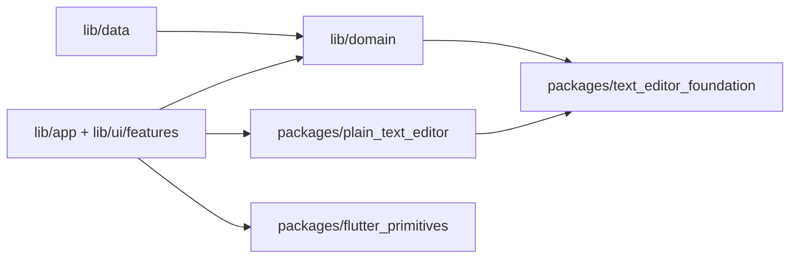

# 架构说明

## 依赖方向

`lib/domain` 描述 Zephyr 书库、配置和仓储协议；`lib/data` 实现 SQLite、文件、备份及云端适配器；`lib/ui/features` 负责界面和 ViewModel；`lib/app` 负责组装。UI 调用仓储接口，不在 Widget 中直接写 `Room.db`。

`packages/text_editor_foundation` 是纯 Dart 的缩进、词边界和边距计算，可供领域层与非 Flutter 工具复用。`packages/plain_text_editor` 是 Flutter 编辑内核：文档与选区、输入控制器、段落布局、装饰绘制、手势和渲染对象。它只依赖 Flutter 和基础包，不导入 Zephyr 的书库、设置、主题或云服务。Zephyr 特有的编辑器外壳 `zephyr_plain_text_editor.dart` 负责键盘快捷键、工作区交互和应用样式。

`packages/flutter_primitives` 放与业务无关的响应式阈值、可拖动分栏把手和嵌套返回导航。Zephyr 的主题、控件风格、状态栏和书库组件仍在 `lib/ui/core`，因为它们使用应用设计令牌或业务状态。

旧的 `lib/domain/...` 和 `lib/ui/features/editor/plain_text/{document,input,layout,render,gestures,decoration}/...` 路径保留兼容导出；现有外部调用与测试不需迁移。新代码直接导入相应的 `package:text_editor_foundation/...`、`package:plain_text_editor/...` 或 `package:flutter_primitives/...`。每个包的 `lib/<package-name>.dart` 是公共入口。

## 数据与状态

书库由 `WritingLibraryRepository` 边界管理。`PureWriterWritingLibraryRepository` 和 `PureWriterDatabase` 实现 PureWriter v27 的读写协议。启动服务尝试上次书库，失败时使用应用支持目录的临时书库。Zephyr 自有的草稿和元数据表不能改变 PureWriter 的 Room 指纹。备份与同步在书库 ViewModel 刷新待保存内容后运行。

设置通过独立仓储保存到应用支持目录。视图只持有 ViewModel 与临时交互状态；可单测的规则留在 domain 或独立包。跨功能复用的 Flutter 组件应先判断是否依赖 Zephyr 品牌：无依赖则进入 `flutter_primitives`，依赖主题令牌则留在 `lib/ui/core`。

## 扩展新产品

新产品可通过 path 或发布版本依赖所需的 `packages/` 包。非 Flutter 工具只需基础包；Flutter 产品可再选编辑内核和通用组件。它自行实现书库/数据适配器、主题、快捷键与编辑器外壳；不要依赖 `package:zephyr/...` 的兼容导出。复用编辑内核时，以 `PlainTextEditingController`、`EditorTypography` 和 `PlainTextLayoutEngine` 为入口，并在所有有 `dispose` 的对象结束使用时释放资源。
