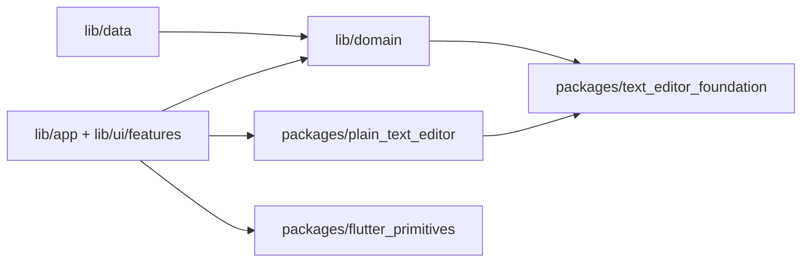

# 架构说明

The mobile selection toolbar belongs to `ZephyrPlainTextEditor` in the app UI layer. Its `onShareSelectedText` callback passes the selected text and the share button's screen rectangle to the workspace, which invokes the platform share sheet. Selection and editing remain in `plain_text_editor`; the reusable package has no share-plugin dependency.

In `plain_text_editor`, selection boxes fill line leading and paragraph gaps, while decoration boxes follow text glyph height. Search and paired-punctuation highlights use decoration boxes so their paint does not grow with line spacing.

## 依赖方向

`lib/domain` 描述 Zephyr 书库、配置和仓储协议；`lib/data` 实现 SQLite、文件、备份及云端适配器；`lib/ui/features` 负责界面和 ViewModel；`lib/app` 负责组装。UI 调用仓储接口，不在 Widget 中直接写 `Room.db`。

`packages/text_editor_foundation` 是纯 Dart 的缩进、词边界和边距计算，可供领域层与非 Flutter 工具复用。`packages/plain_text_editor` 是 Flutter 编辑内核：文档与选区、输入控制器、段落布局、装饰绘制、手势和渲染对象。它只依赖 Flutter 和基础包，不导入 Zephyr 的书库、设置、主题或云服务。Zephyr 特有的编辑器外壳 `zephyr_plain_text_editor.dart` 负责键盘快捷键、工作区交互和应用样式。

`packages/flutter_primitives` 放与业务无关的响应式阈值、可拖动分栏把手和嵌套返回导航。Zephyr 的主题、控件风格、状态栏和书库组件仍在 `lib/ui/core`，因为它们使用应用设计令牌或业务状态。

旧的 `lib/domain/...` 和 `lib/ui/features/editor/plain_text/{document,input,layout,render,gestures,decoration}/...` 路径保留兼容导出；现有外部调用与测试不需迁移。新代码直接导入相应的 `package:text_editor_foundation/...`、`package:plain_text_editor/...` 或 `package:flutter_primitives/...`。每个包的 `lib/<package-name>.dart` 是公共入口。

## 数据与状态

书库由 `WritingLibraryRepository` 边界管理。`PureWriterWritingLibraryRepository` 和 `PureWriterDatabase` 实现 PureWriter v27 的读写协议。启动服务尝试上次书库，失败时使用应用支持目录的临时书库。Zephyr 自有的草稿和元数据表不能改变 PureWriter 的 Room 指纹。备份与同步在书库 ViewModel 刷新待保存内容后运行。

桌面端关闭窗口时先刷新待保存内容并释放书库锁；若本地自动备份开启，或「开启云备份」且已连接 WebDAV，则在当前进程中等待备份完成：先创建一份本地自动 `.pwb`，再在云备份开启时将该文件上传（不拉取合并）；失败则重新显示窗口并保留编辑状态。打开应用时（及移动端 resume）在云备份与自动同步均开启时可 `pullIfNewer` 合并较新远端快照。移动端主动返回退出在已开启云备份时等待上传成功；Home/多任务、进程被杀后由已入队任务继续的路径经 `MobileBackgroundBackup`：先 `flushPending`，再向 Android WorkManager 注册 expedited one-off（`ForegroundServiceConfig` / `dataSync`，文案「正在备份」）；完成后通知自动消失，不再弹成功提示。共享逻辑在 `HeadlessExitBackup`。本地 `.pwb` 由 `PureWriterBackup` 统一限制为最近 25 份 Zephyr 文件；远端历史备份由 `CloudSyncService` 在上传后限制为 25 份。纯纯写作自身的本地备份不在清理范围内。

当前工作区只保留一个用户选择的书库目录；重新选择目录会替换当前选择，不删除原目录。旧版多文库布局启动时只读取原活动书库。云同步由 `CloudSyncService` 编排，`WebDavClient` 实现坚果云 WebDAV 文件操作。凭据只存入系统安全存储；`.pwb` 快照、平台分轨设置包（`settings-desktop.json` / `settings-mobile.json`）、manifest 和历史备份位于 WebDAV 根目录的 `Zephyr/`。远端 manifest 中的书库 ID 与本地不同时：若本地尚无正文则认领远端 ID 以允许列表/拉取/恢复（新机空目录）；本地已有正文或上传入口仍拒绝，且拒绝把空书库上传覆盖已有云端快照。远端书库快照经本地备份恢复接口合并（有正文）或覆盖（空库拉取）；设置包在恢复/拉取后写入应用支持目录并触发 ViewModel 重载。桌面端可读旧版共享 `settings.json` 一次以迁移；移动端不读该旧文件，避免桌面侧栏宽度等布局污染手机。紧凑布局抽屉使用固定的 `WorkspaceLayout.mobileDrawerWidth`，不跟桌面可调 `sidebarWidth`。

设置通过独立仓储保存到应用支持目录，并经 `CloudSettingsBundle` 按平台上传（不含 WebDAV 凭据与 `cloud_sync_preferences`）。视图只持有 ViewModel 与临时交互状态；可单测的规则留在 domain 或独立包。跨功能复用的 Flutter 组件应先判断是否依赖 Zephyr 品牌：无依赖则进入 `flutter_primitives`，依赖主题令牌则留在 `lib/ui/core`。

列表式面板统一经 `showZephyrModalSheet`（`lib/ui/core/zephyr_bottom_sheet.dart`）弹出：移动端仍为底部抽屉，桌面端为居中模态对话框；勿直接调用 `showModalBottomSheet`。

## 扩展新产品

新产品可通过 path 或发布版本依赖所需的 `packages/` 包。非 Flutter 工具只需基础包；Flutter 产品可再选编辑内核和通用组件。它自行实现书库/数据适配器、主题、快捷键与编辑器外壳；不要依赖 `package:zephyr/...` 的兼容导出。复用编辑内核时，以 `PlainTextEditingController`、`EditorTypography` 和 `PlainTextLayoutEngine` 为入口，并在所有有 `dispose` 的对象结束使用时释放资源。
