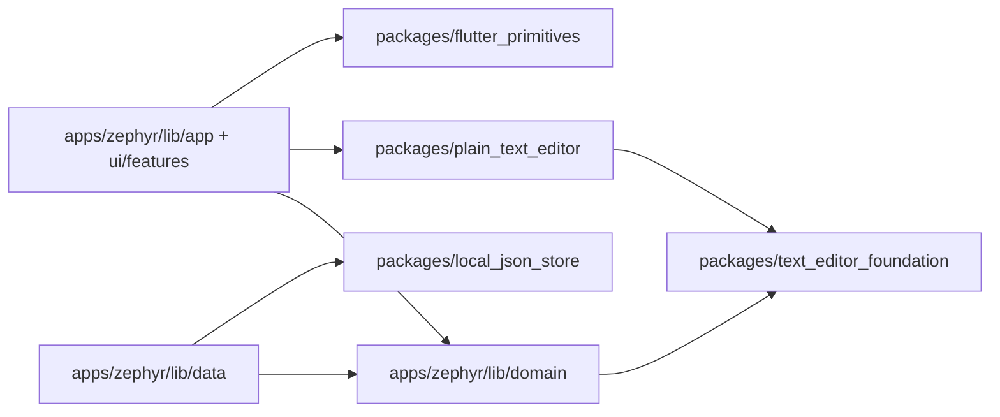

# 架构说明

The mobile selection toolbar belongs to `ZephyrPlainTextEditor` in the app UI layer. Its `onShareSelectedText` callback passes the selected text and the share button's screen rectangle to the workspace, which invokes the platform share sheet. Selection and editing remain in `plain_text_editor`; the reusable package has no share-plugin dependency.

In `plain_text_editor`, selection boxes fill line leading and paragraph gaps, while decoration boxes follow text glyph height. Search and paired-punctuation highlights use decoration boxes so their paint does not grow with line spacing.

## 依赖方向

`apps/zephyr/lib/domain` 描述 Zephyr 书库、配置和仓储协议；`apps/zephyr/lib/data` 实现 SQLite、文件、备份及云端适配器；`apps/zephyr/lib/ui/features` 负责界面和 ViewModel；`apps/zephyr/lib/app` 负责组装。UI 调用仓储接口，不在 Widget 中直接写 `Room.db`。

`packages/text_editor_foundation` 是纯 Dart 的缩进、词边界、字数和边距计算，可供领域层与非 Flutter 工具复用。`packages/plain_text_editor` 是 Flutter 编辑内核：文档与选区、输入控制器、段落布局、装饰绘制、手势和渲染对象。它只依赖 Flutter 和基础包，不导入 Zephyr 的书库、设置、主题或云服务。Zephyr 特有的编辑器外壳 `zephyr_plain_text_editor.dart` 负责键盘快捷键、工作区交互和应用样式。

`packages/flutter_primitives` 放与业务无关的响应式阈值、可拖动分栏把手、嵌套返回导航、滑动抽屉、双页编辑容器和悬浮层保持机制。无需 Zephyr 主题模型的尺寸、形状、浮层阴影、滚动条颜色和图标工具栏样式也在此包。应用保留旧 `Zephyr*` 名称作为类型别名，新产品直接使用包内 `SwipeDrawer`、`DualEditorPager`、`FloatingOverlayScope`、`ChromeControls`、`FloatingChrome` 等 API。Zephyr 的主题组装、状态栏和书库组件仍在 `apps/zephyr/lib/ui/core`，因为它们使用应用设计令牌或业务状态。

`packages/local_json_store` 是纯 Dart 的 JSON map 文件读写模块。应用层负责注入支持目录、相对文件路径、错误文案及配置模型；包不依赖 `path_provider` 或 Zephyr。七个 Zephyr 配置存储类保留原有路径和公开构造函数，委托给 `JsonMapFileStore`。

通用设置 UI 的公共入口是 `package:flutter_primitives/settings/adaptive_settings.dart`：新产品向 `AdaptiveSettingsPage` 或可嵌入的 `AdaptiveSettingsView` 传入 `SettingsGroup` 和 toggle、choice、number、action 设置项，组件按可用宽度自动选择列表卡片、底部选项面板、桌面对话框或行内控件。值、持久化回调和文案由宿主提供。Zephyr 原设置控件的旧类名保留兼容别名；含 Zephyr 本地化、主题令牌和复杂配置流程的适配器仍在应用层。

旧的 `apps/zephyr/lib/domain/...` 和 `apps/zephyr/lib/ui/features/editor/plain_text/{document,input,layout,render,gestures,decoration}/...` 路径保留兼容导出；现有外部调用与测试不需迁移。新代码直接导入相应的 `package:text_editor_foundation/...`、`package:plain_text_editor/...` 或 `package:flutter_primitives/...`。每个包的 `lib/<package-name>.dart` 是公共入口。

## 数据与状态

书库由 `WritingLibraryRepository` 边界管理。`PureWriterWritingLibraryRepository` 和 `PureWriterDatabase` 实现 PureWriter v27 的读写协议。启动服务尝试上次书库，失败时使用应用支持目录的临时书库。Zephyr 自有的草稿和元数据表不能改变 PureWriter 的 Room 指纹。备份与同步在书库 ViewModel 刷新待保存内容后运行。

移动端前台编辑器与后台备份任务可能由不同 Flutter 引擎同时访问 `Room.db`；每次打开都使用独立的 sqflite 连接，后台任务关闭连接不得关闭前台编辑器的连接。正文写入前会排队写入恢复草稿；正常离开时先等待待保存写入完成，再安排后台备份。

桌面端关闭窗口时先刷新待保存内容并释放书库锁；若本地自动备份开启，或「开启云备份」且已连接 WebDAV，则在当前进程中等待备份完成：先创建一份本地自动 `.pwb`，再在云备份开启时将该文件上传（不拉取合并）；失败则重新显示窗口并保留编辑状态。移动端三种离开路径（根级返回、Home/多任务、划掉）统一为：先 `flushPending` 保证本地落盘，再经 `MobileBackgroundBackup` 向 WorkManager 注册 expedited one-off（`ForegroundServiceConfig` / `dataSync`）；根级返回不再前台等待云上传，flush 后即可退出。进程被杀后若入队已成功，系统可另起进程继续；无法保证强制停止后仍上传。正文成功写入时若云备份开启则持久化 `CloudSyncPreferences.pendingCloudBackup`；仅云上传成功后清位。下次启动在草稿恢复流程之后，若仍 pending 且已登录则再次入队补传。共享上传逻辑在 `HeadlessExitBackup`。本地 `.pwb` 由 `PureWriterBackup` 统一限制为最近 25 份 Zephyr 文件；远端历史备份由 `CloudSyncService` 在上传后限制为 25 份。纯纯写作自身的本地备份不在清理范围内。

当前工作区只保留一个用户选择的书库目录；重新选择目录会替换当前选择，不删除原目录。旧版多文库布局启动时只读取原活动书库。云同步由 `CloudSyncService` 编排，`WebDavClient` 实现坚果云 WebDAV 文件操作。凭据只存入系统安全存储；`.pwb` 快照、平台分轨设置包（`settings-desktop.json` / `settings-mobile.json`）、manifest 和历史备份位于 WebDAV 根目录的 `Zephyr/`。远端 manifest 中的书库 ID 与本地不同时：若本地尚无正文则认领远端 ID 以允许列表/拉取/恢复（新机空目录）；本地已有正文或上传入口仍拒绝，且拒绝把空书库上传覆盖已有云端快照。远端书库快照经本地备份恢复接口合并（有正文）或覆盖（空库拉取）。合并时章节以双方历史里相同的 `updateTime` 加正文作为共同旧版本：两边都改过的段落会合成一章，互不重叠的修改都留下，同一处改写则用冲突标记把两份正文都留在章内；找不到共同旧版本时仍由较新的 `updateTime` 整章取胜，落选正文写入 History。设置包在恢复/拉取后写入应用支持目录并触发 ViewModel 重载。桌面端可读旧版共享 `settings.json` 一次以迁移；移动端不读该旧文件，避免桌面侧栏宽度等布局污染手机。紧凑布局抽屉使用固定的 `WorkspaceLayout.mobileDrawerWidth`，不跟桌面可调 `sidebarWidth`。

WebDAV 历史备份列表只接受当前账号 `Zephyr/Backups/` 的直接子文件，并将服务端返回的 href 规范化为该文件的本端地址；删除旧备份和下载恢复时仍按当前账号与直接子路径校验，不访问嵌套目录或其他账号。

设置通过独立仓储保存到应用支持目录，并经 `CloudSettingsBundle` 按平台上传（不含 WebDAV 凭据与 `cloud_sync_preferences`）。LLM 供应商与非敏感选项写入 `zephyr/llm_preferences.json`（含在 `CloudSettingsBundle` 云/本地设置备份中）；各供应商 API Key 仅存 `flutter_secure_storage`，不进入云设置包。`LlmGateway` 负责列出模型与对话请求（OpenAI 兼容、Anthropic、Google Gemini）。每章 AI 对话保存在书库 `Room.db` 的 Zephyr 表 `ZephyrAiSession` / `ZephyrAiMessage`（随 `.pwb` 备份与合并恢复）；长会话在发送前可自动摘要旧轮次写入 `context_summary`。视图只持有 ViewModel 与临时交互状态；可单测的规则留在 domain 或独立包。跨功能复用的 Flutter 组件应先判断是否依赖 Zephyr 品牌：无依赖则进入 `flutter_primitives`，依赖主题令牌则留在 `lib/ui/core`。

列表式面板统一经 `showZephyrModalSheet`（`apps/zephyr/lib/ui/core/zephyr_bottom_sheet.dart`）弹出：移动端仍为底部抽屉，桌面端为居中模态对话框；勿直接调用 `showModalBottomSheet`。

## 扩展新产品

新产品可通过 path 或发布版本依赖所需的 `packages/` 包。非 Flutter 工具可选文本基础包和 JSON 文件存储包；Flutter 产品可再选编辑内核和通用组件。它自行实现书库/数据适配器、主题、快捷键与编辑器外壳；不要依赖 `package:zephyr/...` 的兼容导出。复用编辑内核时，以 `PlainTextEditingController`、`EditorTypography` 和 `PlainTextLayoutEngine` 为入口，并在所有有 `dispose` 的对象结束使用时释放资源。
